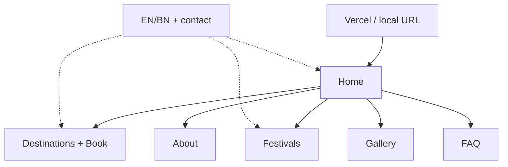
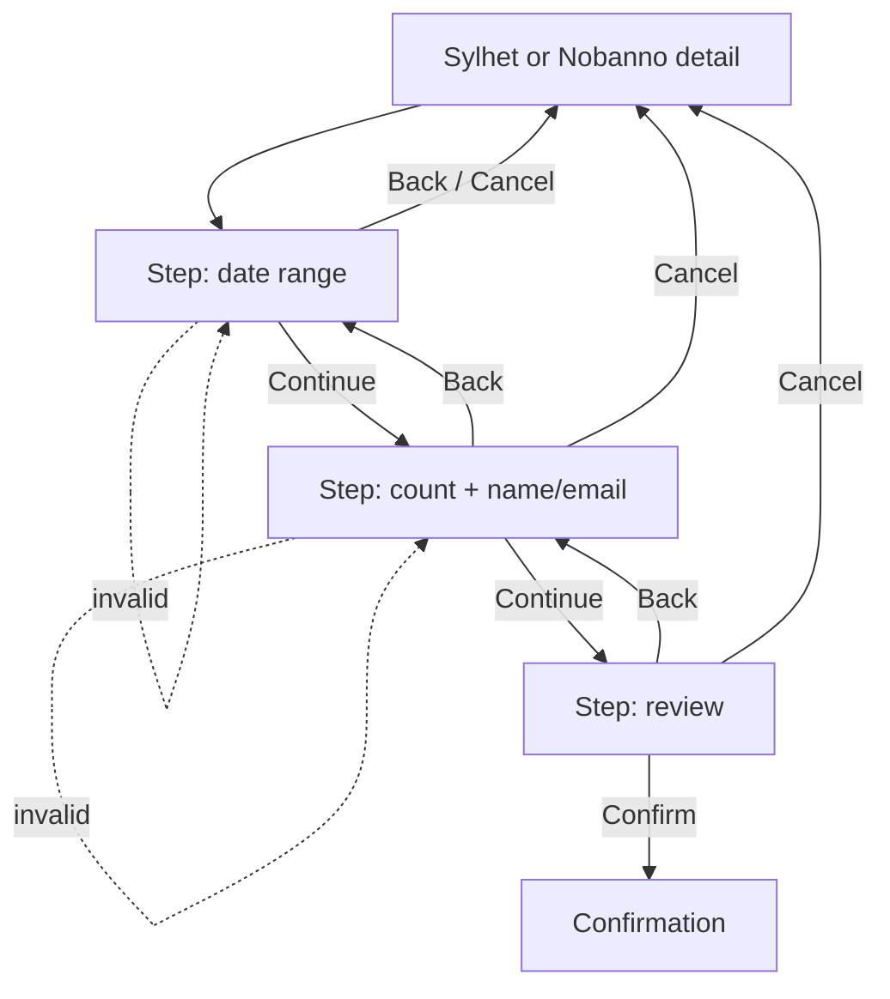

# User flow — interaction map

End-to-end **interaction map** of the product (screens, states, and paths — not visual design).

Derived from `docs/product.md`. During `/setup`, Owner refinements here **must** sync back into the product spec.

**Status:** accepted  
**Last synced with product:** 2026-11-25 (R8–R10 sync)

---

## Entry points

- Stakeholder or traveler opens the **Vercel live URL** (or local static site) → **Home**
- Deep link / nav to: About · Destinations + Book · Festivals · Gallery · FAQ · policy stubs · Sylhet detail · Nobanno Utshob detail
- Language switch control available from global chrome (EN ↔ BN) on all core pages
- Persistent call / WhatsApp affordances (canonical demo contact) from global chrome

---

## Primary flows

### Flow A — Discover & orient (Home → key areas)

1. Land on **Home** (promise + CTAs; no empty sections).
2. Choose a path: **Destinations + Book**, **Festivals**, **About**, or **Gallery**.
3. Optionally switch **EN ↔ BN** at any time; content for the current page updates.

### Flow B — Place-based tour (Destinations + Book → Sylhet → booking demo)

1. Open **Destinations + Book** (single area: browse places and book from here).
2. Browse destination cards (live-site imagery).
3. Open **Sylhet** detail.
4. Review overview, itinerary summary, inclusions/exclusions, pricing by travel type, deposit/cancellation summary near price.
5. Primary CTA → **Flow D** (booking mock) for that travel type.
6. Optional secondary CTA → consultation/enquiry local success (no backend).

### Flow C — Event-based festival (Festivals → Nobanno Utshob → optional booking)

1. Open **Festivals** list (events / seasons — not a place index).
2. Open **Nobanno Utshob** detail (event-first; host place secondary).
3. Review event meaning, timing/season, guest experience.
4. Optional primary CTA → **Flow D** if presented as bookable in the demo.
5. Optional secondary enquiry → local success only.

### Flow D — Booking demo (mock)

1. Enter from Sylhet or Nobanno detail after choosing travel type / Book.
2. **Step 1 — Dates:** pick date range → Continue (inline validation if empty).
3. **Step 2 — Travelers:** traveler count + name + email → Continue (inline validation if invalid/empty).
4. **Step 3 — Review:** summary of package, dates, travelers, contact → Confirm (mock).
5. **Confirmation:** success / reference-style screen (no payment, no account, no real booking).
6. From any step: **Back** to previous step, or **Cancel** → return to package detail.

### Flow E — Trust & info (About, FAQ, policies)

1. Open **About** — concept, rationale, impact (concise).
2. Open **FAQ** — adapted Q&A groups as needed for the presentation.
3. From footer, open short **Terms / Privacy / EMI** stubs.
4. Return via nav/footer to browse or book paths.

### Flow F — Gallery

1. Open **Gallery**.
2. Browse live-site imagery in redesigned layout.
3. Exit via nav to Home / Destinations / Festivals / etc.

### Flow G — Responsive presentation use

1. Open site on phone, tablet, or desktop.
2. Use nav (including mobile pattern), primary CTAs, and booking steps without horizontal overflow or unreachable actions.
3. Stakeholder shares Vercel URL; recipient repeats Flow A–F on their device.

---

## Branches & alternates

| Branch | Behavior |
|--------|----------|
| Empty/invalid booking fields | Stay on step; show simple inline validation; do not advance |
| Back during booking | Previous step; retain entered mock values when practical |
| Cancel during booking | Exit mock → package detail (Sylhet or Nobanno) |
| Consultation / enquiry CTA | Local success state only; no email/API |
| Language switch mid-flow | Page/chrome content switches EN ↔ BN; booking mock labels switch too |
| Non-sample destination/festival cards | **Display-only** — no navigation to Sylhet / Nobanno samples |
| No account / login path | Not offered |

---

## Success / exit states

| Flow | Success / done |
|------|----------------|
| A | Visitor understands offer and reaches Destinations or Festivals (or About/Gallery) |
| B | Visitor evaluated Sylhet and either completed booking demo or left informed |
| C | Visitor evaluated Nobanno Utshob (and optional booking demo) |
| D | Confirmation screen after mock Confirm |
| E | Visitor read About/FAQ/policy stub and returned to browse |
| F | Visitor viewed gallery imagery |
| G | Site usable on target viewport; live URL shareable |

---

## Non-goals for this map

- Real payment, deposit capture, EMI checkout
- Login / register / wallet / booking history
- Live availability or inventory
- Blog, newsletter, dream-destination modal
- Admin / CMS
- Separate “Book a Tour” IA from Destinations
- Festival pages structured as destination catalog pages
- Astro/SSR requirement

---

## Open questions

None blocking dual-lock. (Language switch mechanism — toggle vs mirrored pages — deferred to architecture/decisions.)
